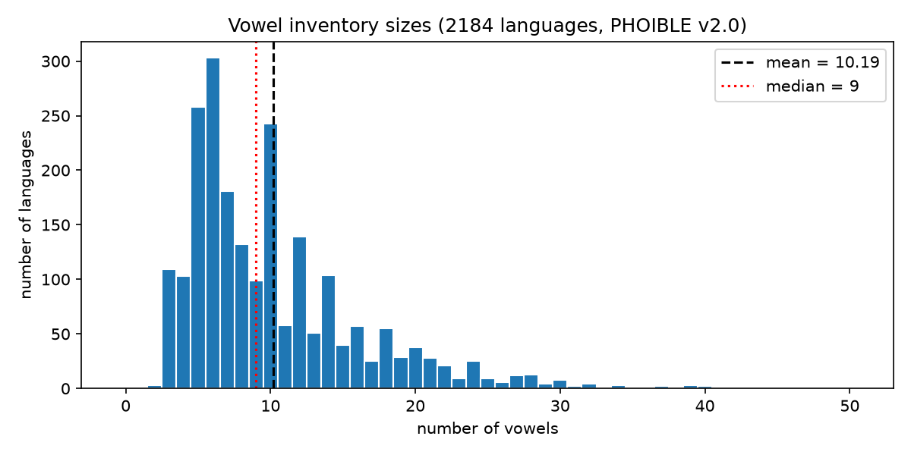
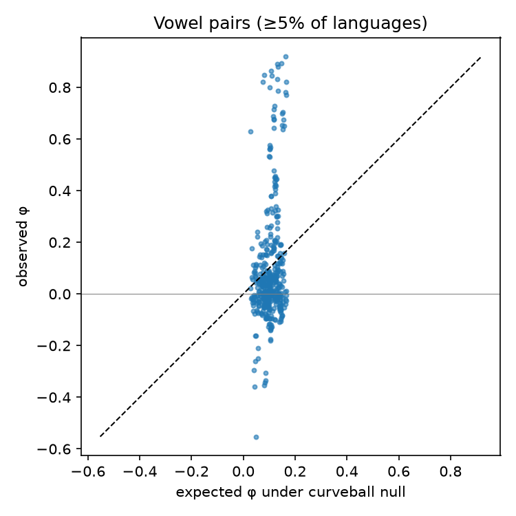

# A Statistical Analysis of Vowel Inventories of World Languages

A data-analysis project on [PHOIBLE 2.0](https://phoible.org), a cross-linguistic database of phoneme inventories (2,184 languages after selecting one inventory per language). It tests two vowel universals often cited in typology (Maddieson 1984; Crothers 1978):

1. almost every language has the vowel triangle [i], [a], [u] (or close equivalents);
2. marked vowels (nasal, long, front rounded) imply their plain counterparts.

It also studies pairwise vowel associations, the effect of genealogical bias (Galton's problem), and association-rule mining with Apriori.

## Main findings

- **The triangle is a strong statistical tendency, not an absolute universal.** Depending on what counts as a "close equivalent", 80–95% of languages have all three vowels; with one language per family (1,000 resamples) the figure is about 81% [79–83%]. Many exceptions are transcription conventions of particular sources, but some are genuine (e.g. two-vowel Chadic systems).
- **Nasal → oral and long → short are real implications.** The plain counterpart is present 91–97% of the time, against a base rate of 68%. **[y] → [i] & [u] is not**: it holds exactly at the base rate of [i] & [u] (0.93 vs 0.92).
- **Independence is the wrong baseline for co-occurrence.** A curveball null model preserving inventory sizes and vowel frequencies removes about half of the "significant" positive associations. The strongest negative associations (a–ɑ, e–e̞, o–o̞) reflect source notation rather than phonology.
- **Apriori cannot see implicational universals.** Their antecedents are rare, so a minimum-support threshold filters them out.

| | |
|---|---|
|  |  |

## Data

Not included in this repository. Download both files into the project folder:

- `phoible.csv`, PHOIBLE v2.0 (CC BY-SA 3.0): `https://raw.githubusercontent.com/phoible/dev/v2.0/data/phoible.csv`
  (sha256 `cc19b7a15b7614f6c10d359cb62fbbf8692da46aef53feb1de09a561e336b618`)
- `glottolog_languages_v4.1.csv`, Glottolog 4.1 (CC BY 4.0): `https://raw.githubusercontent.com/glottolog/glottolog-cldf/v4.1/cldf/languages.csv`

## Running

```bash
python3 -m venv .venv && .venv/bin/pip install -r requirements.txt
for s in s2_data s3_universals s3b_pairs s4_galton s5_apriori extra_checks; do .venv/bin/python $s.py; done
```

| file | content |
|---|---|
| `lab.py` | shared conventions: inventory selection, vowel definition, diacritic stripping (`base()`) |
| `s2_data.py` | descriptive statistics, disagreement between sources, IQR outliers |
| `s3_universals.py` | the two universals and their exceptions |
| `s3b_pairs.py` | χ², Fisher, mutual information, φ, multiple testing, curveball null model |
| `s4_galton.py` | family/macroarea representation, genealogically balanced resampling |
| `s5_apriori.py` | frequent itemsets and association rules (mlxtend) |
| `extra_checks.py` | robustness checks |

Outputs, tables and figures are in `results/`. All randomness uses seed 0.

## Notes

Done as a lab for an M2 course at Université Paris Cité. The code was written with the help of Claude (Anthropic).

## References

- Crothers, J. (1978). Typology and universals of vowel systems. In *Universals of Human Language 2*. Stanford UP.
- Hammarström, H., Forkel, R. & Haspelmath, M. (2019). *Glottolog 4.1*. Jena: MPI-SHH.
- Maddieson, I. (1984). *Patterns of Sounds*. Cambridge UP.
- Moran, S. & McCloy, D. (eds.) (2019). *PHOIBLE 2.0*. Jena: MPI-SHH.
- Strona, G. et al. (2014). A fast and unbiased procedure to randomize ecological binary matrices with fixed row and column totals. *Nature Communications* 5, 4114.
